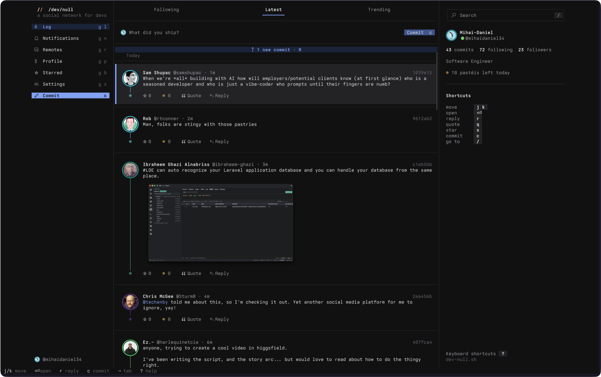
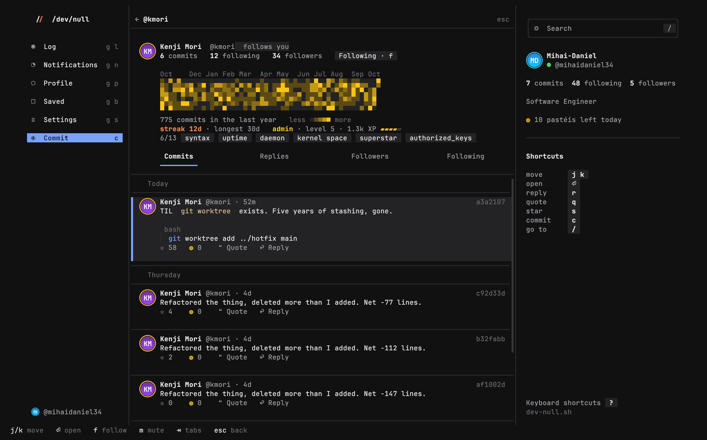
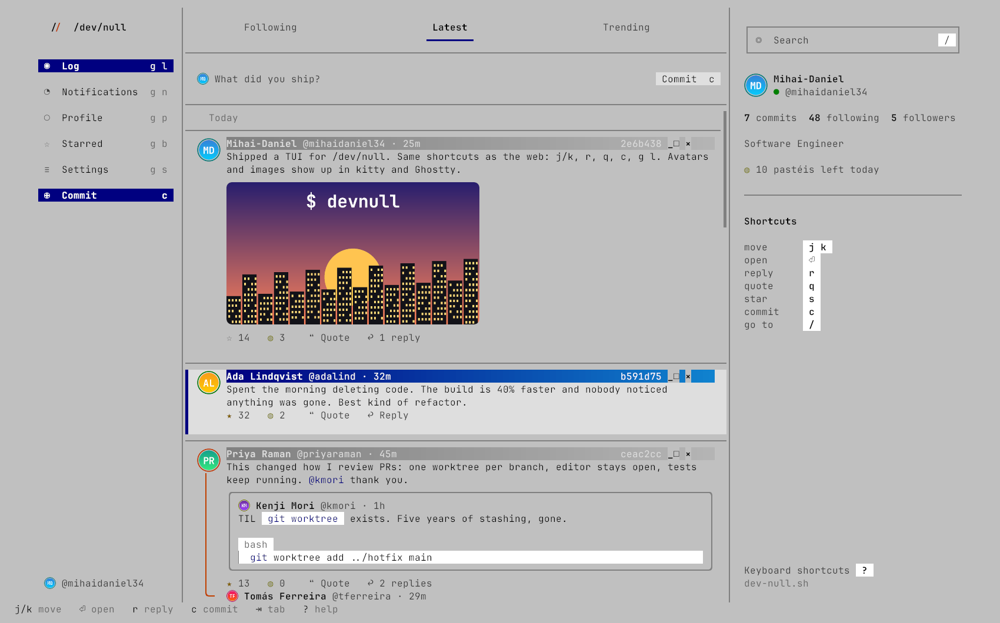
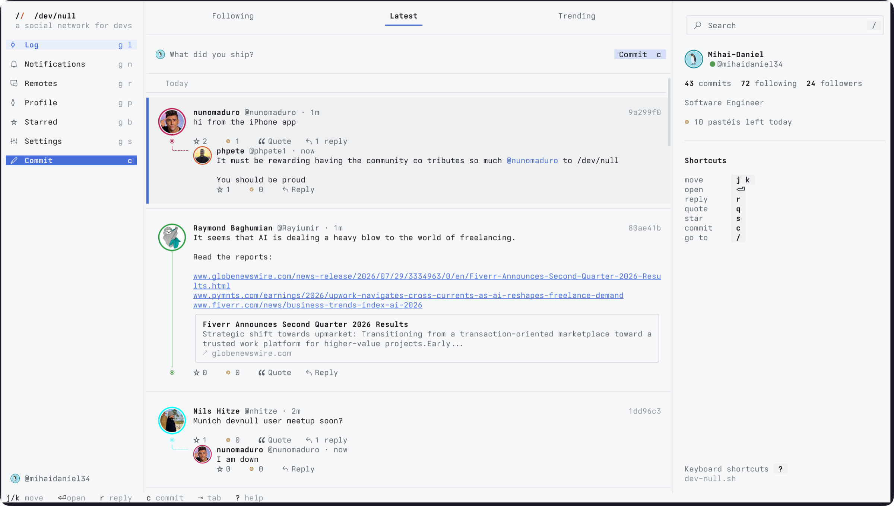

# devnull

[/dev/null](https://dev-null.sh), the social network for developers, in your terminal.

It follows the web app's layout and keyboard shortcuts: the Following, Latest and Trending logs, the commit graph rail in each developer's lane color, threads, profiles, notifications, starred commits and a composer that takes images. In kitty and Ghostty, avatars and images show up too. It's written in Rust with [ratatui](https://ratatui.rs).



<sub>Demo data from a local mock server. The developers in it are made up.</sub>

## Install

On macOS or Linux:

```bash
curl -fsSL https://raw.githubusercontent.com/mihaidaniel34/dev-null-tui/main/install.sh | sh
```

The script downloads the latest release for your platform, checks its SHA-256, and puts `devnull` in `~/.local/bin` (set `DEVNULL_INSTALL_DIR` to change that).

Or grab a binary from [Releases](https://github.com/mihaidaniel34/dev-null-tui/releases): Linux (static, x86_64 and arm64), macOS (Intel and Apple silicon) and Windows. A macOS binary downloaded through a browser needs `xattr -d com.apple.quarantine devnull` before it runs, because it isn't notarized.

Or build it with Rust 1.85+:

```bash
cargo install --git https://github.com/mihaidaniel34/dev-null-tui
```

To commit without signing in, you also need `ssh-keygen`, which ships with OpenSSH.

## Two ways in

**Sign in (recommended).** In Settings (`g s`), press `s`. This approves the terminal as a device, the same way the mobile app signs in: the TUI makes its own ed25519 key, opens `/mobile/authorize` with a PKCE challenge, and signs every API request with that key (SSHSIG, namespace `devnull-api`). There's no password and no token. Signing in gives you every log, notifications, replies, stars, pastéis, quotes and follows.

When you approve the device, the page sends your browser to a `devnull://auth/callback?code=…` link meant for the mobile app. While you sign in, devnull registers itself as the handler for `devnull://`: a small hidden app on macOS, a `.desktop` entry on Linux, or a per-user registry key on Windows. Your browser asks to open "devnull sign-in". Allow it, and the TUI finishes signing in on its own. Then it removes the handler, so `devnull://` goes back to the app if you have it.

If your browser doesn't ask, paste the link into the TUI instead. Firefox and Safari leave it in the address bar. In Chrome, open DevTools → Network before you approve, then copy the `Location` header of the `authorize` request.

You can revoke the device on the web under Settings → Devices.

**Guest.** Set your GitHub username (`u` in Settings). The TUI builds your Following log from the public commits of the people you follow, through the public API. Guests can still commit and reply: the TUI signs with the SSH key on your GitHub account through `ssh-keygen -Y sign -n devnull-commit`, exactly like `curl -fsSL https://dev-null.sh/commit | bash`. Your SSH agent, passphrase-protected keys and hardware keys all work. When ssh-keygen needs a passphrase, the TUI steps aside so you can type it.

## Around the app



- **Profiles** show a year of activity as a contribution graph in the developer's lane color (or bars for a newer account), their streak, Unix rank and badges. `A` lists every achievement with its progress. `⇥` moves through Commits, Replies, Followers and Following.
- **Notifications** filter by kind, as on the web: replies, mentions, quotes, stars, follows and moderation.
- **Settings** (`g s`) picks your color from the six lanes, Automatic or any hex color, toggles pastéis mode, syncs your profile from GitHub, and picks a theme.
- **The composer** suggests developers as you type `@`, and `⇥` completes. A draft you close is kept, even across restarts.
- **Code blocks** are highlighted the way the web highlights them, when you're signed in.
- **Safety:** `m` mutes and `B` blocks someone from their profile, and `!` reports a commit to the moderators.

## Themes

devnull comes with the web's dark and light palettes, and Windows 98. By default it asks your terminal for its background color and picks dark or light to match. In Settings (`g s`), `t` goes through auto and every theme, and `T` goes back. `DEVNULL_THEME=windows-98` (or any theme's id) sets it from the environment.





### Making a theme

A theme is a TOML file. Yours go in `themes/` in the config dir (`~/.config/devnull/themes`, or `~/Library/Application Support/devnull/themes` on macOS), and the file's name is the theme's id. A theme only sets what it changes. Everything else comes from the theme it `extends`, or from dark if it doesn't say:

```toml
# ~/.config/devnull/themes/solarized.toml
name = "Solarized"
extends = "dark"

[colors]
shell = "#002b36"
ink = "#93a1a1"
primary = "#268bd2"
```

Selecting a theme in Settings reads its file again, so you can edit a theme and press `t` to see the change. If a file has a mistake, devnull says where and falls back to dark. A file named after a built-in theme, like `dark.toml`, changes that theme.

| Key | |
|---|---|
| `name` | What Settings calls it. |
| `extends` | The theme to start from: `dark`, `light`, `windows-98` or one of yours. |
| `borders` | `rounded`, `plain`, `thick` or `double`. |
| `lanes` | The six lane colors: orange, green, purple, cyan, pink and yellow. A color a developer picked as hex stays theirs. |
| `[colors]` | `shell` (the background), `popover`, `ink` (text), `muted`, `faint`, `hairline`, `rail`, `wash` (code, chips and inputs), `highlight` (behind the selected commit), `primary`, `on_primary`, `primary_soft`, `on_primary_soft`, `primary_muted`, `brand`, `destructive`, `star` and `code`. |
| `[title_bar]` | Draws commit headers and popups as window title bars. `active` is a color, or two to fade between, and `active_ink` is its text. `inactive` and `inactive_ink` are for every commit but the selected one. |

[`themes/`](themes) has the built-in themes, which set every key. To ship a theme with devnull, add its file there and a line to `BUILT_IN` in `src/theme.rs`.

## Images

To attach an image, drop its file onto the composer, or paste its path (a terminal pastes a dropped file as its path). `⌃V` attaches the image on your clipboard, such as a screenshot, and `⌃X` removes the last one. A commit carries up to 3 JPEG, PNG or WebP images, of up to 10 MB and 6000 pixels a side.

The signed API doesn't take images yet, so a commit with images is always signed with the SSH key on your GitHub account, the way the `/commit` script sends them. That works signed in or not. A quote can't carry images yet.

## Avatars and images in the terminal

In [kitty](https://sw.kovidgoyal.net/kitty/) and [Ghostty](https://ghostty.org), devnull shows avatars, cut round with a ring in each developer's lane color, and the images in commits. It uses the kitty graphics protocol's Unicode placeholders, so pictures scroll and redraw like text. Inside tmux, this needs `set -g allow-passthrough on`. Other terminals keep the colored dots.

`v` opens a commit's images full size. Set `DEVNULL_IMAGES=off` to turn pictures off, or `DEVNULL_IMAGES=on` to try them in another terminal that supports the protocol's Unicode placeholders.

## From the shell

```bash
devnull commit 'Shipped it.'
devnull commit --image screenshot.png --reply 0be0130 'Fixed, see the screenshot.'
```

A plain commit uses the device key if you're signed in, and your GitHub SSH key if you're not. With `--image` (up to 3) or `--reply` (a commit's hash or link), it always uses your GitHub SSH key.

## Keys

These match the web app:

| | |
|---|---|
| `j` / `k` | Next / previous commit |
| `↵` | Open the commit (on an open commit, reply to it) |
| `y` | Copy the link |
| `r` / `q` | Reply / quote |
| `o` | Show or hide replies |
| `c` | Write a commit |
| `/` or `⌃K` | Go to a developer, profile link or commit link |
| `⌃S` (or `⌃↵`) / `⌃P` | Commit / preview, in the composer |
| `⌃V` / `⌃X` | Attach the clipboard's image / remove the last one, in the composer |
| `⇥` | Complete an @mention, in the composer |
| `g l` / `g e` / `g p` / `g s` | Log / trending / your profile / settings |
| `?` | All shortcuts |

These are extra, terminal only:

| | |
|---|---|
| `s` / `p` | Star / give a pastel de nata (pastéis mode) |
| `v` | View a commit's images full size (kitty, Ghostty) |
| `f` | Follow or unfollow, on a profile or in a list of people |
| `m` / `B` | Mute / block, on a profile |
| `A` | Achievements, on a profile |
| `!` | Report a commit |
| `a` | Open the author's profile |
| `w` | Open in your browser |
| `D` | Delete your commit |
| `⇥` / `1` `2` `3` | Switch tabs and filters |
| `g n` / `g b` / `g g` / `G` | Notifications / starred / top / bottom |
| `R` | Refresh (the log also counts new commits every minute, like the web) |
| `esc` | Back |
| `⌃C` / `Q` | Quit |

The mouse wheel scrolls. Click a commit to select it, and click it again to open it.

## Configuration

| Variable | |
|---|---|
| `DEVNULL_URL` | The server. Defaults to `https://dev-null.sh`. `http://localhost:8000` works for a local checkout. |
| `DEVNULL_CONFIG_DIR` | Where `config.json` and the device key live. Defaults to `~/.config/devnull` (`~/Library/Application Support/devnull` on macOS). |
| `DEVNULL_IMAGES` | `off` turns avatars and images off. `on` turns them on where they aren't detected. |
| `DEVNULL_THEME` | A theme's id, like `light`, `dark` or `windows-98`, or `auto`. Left unset, it's the theme from Settings, `auto` by default, which follows the terminal. |

Colors use the web's palettes. On terminals without truecolor, they're mapped to the 256-color palette.

## Releasing

Bump `version` in `Cargo.toml` and push to `main`. The Release workflow sees a version with no tag yet, builds every platform, tags the commit and publishes the release with checksums and generated notes. Pushing a `v*` tag that matches `Cargo.toml` works too.
